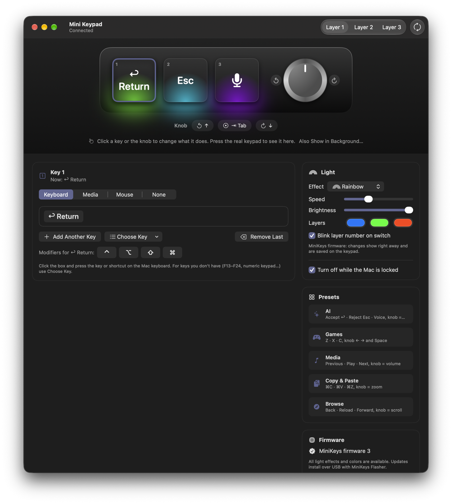
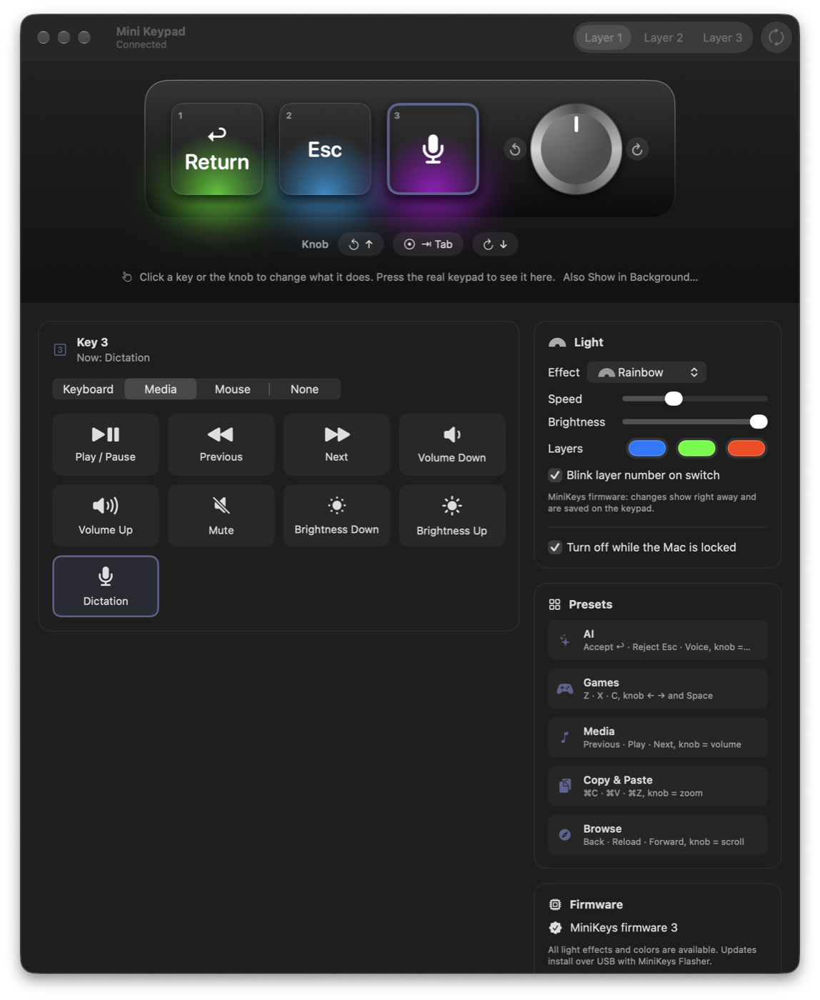
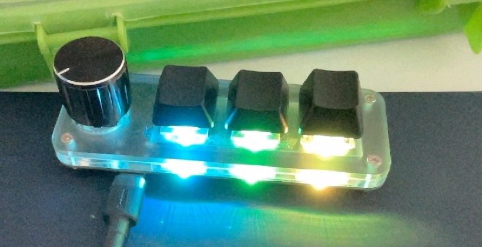

<p align="center"></p>

# MiniKeys

A native macOS app to set up the 3-key + knob USB mini keypads (CH57x chip, USB `1189:8890`, sold
as "MINI KeyBoard"). It replaces the vendor's Windows tool.

<p align="center"></p>

<table>
  <tr>
    <td></td>
    <td></td>
  </tr>
  <tr>
    <td align="center">Record shortcuts, set the lights, apply presets</td>
    <td align="center">Media keys, mouse actions and dictation</td>
  </tr>
</table>

<p align="center"><br>
<sub>The keypad running the MiniKeys firmware's rainbow effect</sub></p>

- **On-screen keypad**: shows the 3 keys and the knob with what each one does, the RGB light as
  the keypad shows it, and live presses (the knob turns on screen).
- **Assign actions**: keyboard shortcuts (record them directly, or pick keys like F13–F24),
  sequences of up to 5 keys, media keys (play, volume, brightness, dictation…) and mouse (clicks
  and scroll).
- **Saved instantly** to the keypad's memory: it works on any computer, without the app.
- **3 layers**, switchable from the toolbar, the Keypad menu (⌘1–⌘3) or the menu bar.
- **Light**: off, on press (the pressed key lights up, in a new color each time) or color wave (a
  light runs over the keys in red, blue and green), with a faithful on-screen preview. Option to
  turn it off while the Mac is locked.
- **Works with the stock firmware and the optional
  [MiniKeys firmware](https://github.com/MeLlamoCarl/MiniKeys-Firmware)**: MiniKeys detects which
  one the keypad runs and, with the MiniKeys firmware, adds any light effect (solid, breathing,
  rainbow, wave, on press, layer color) with your own colors, speed and brightness, plus instant
  layers. The firmware and its installer live in their own repository.
- **Presets**: AI (accept, reject, dictation; the knob picks options), Games, Media, Copy & Paste,
  Browse.

No drivers or special permissions: the app talks to the keypad's programming interface directly
over USB.

## Install

1. Download `MiniKeys-<version>.dmg` from Releases and drag MiniKeys to Applications.
2. The app isn't notarized: the first time, open it, go to **System Settings › Privacy &
   Security** and click **Open Anyway**.

Requires macOS 13 or later, Apple silicon or Intel.

## Build

```bash
scripts/setup-signing.sh  # once per Mac: self-signed identity, keeps permissions across builds
scripts/run-dev.sh        # Debug build, installed in /Applications and launched
scripts/build-release.sh  # universal (arm64 + x86_64), signed → dist/MiniKeys-<version>.dmg
```

Without `setup-signing.sh`, builds are signed ad hoc and macOS forgets the app's privacy
permissions after every build.

## Protocol

See [PROTOCOL.md](PROTOCOL.md).

## Credits

- The keypad's programming protocol was worked out from the vendor's Windows tool and verified on
  the device; [ch57x-keyboard-tool](https://github.com/kriomant/ch57x-keyboard-tool) by kriomant
  (MIT) was a useful reference for the light commands of this keypad family.
- The optional firmware builds on Stefan Wagner's [CH55x libraries](https://github.com/wagiminator)
  and biemster's [RGB Macropad Custom Firmware](https://hackaday.io/project/189914); see
  [MiniKeys-Firmware](https://github.com/MeLlamoCarl/MiniKeys-Firmware) for its credits.

## License

[MIT](LICENSE).

---

Built with the help of AI tools.
